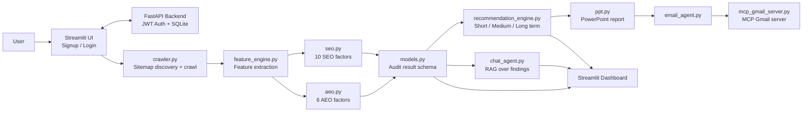
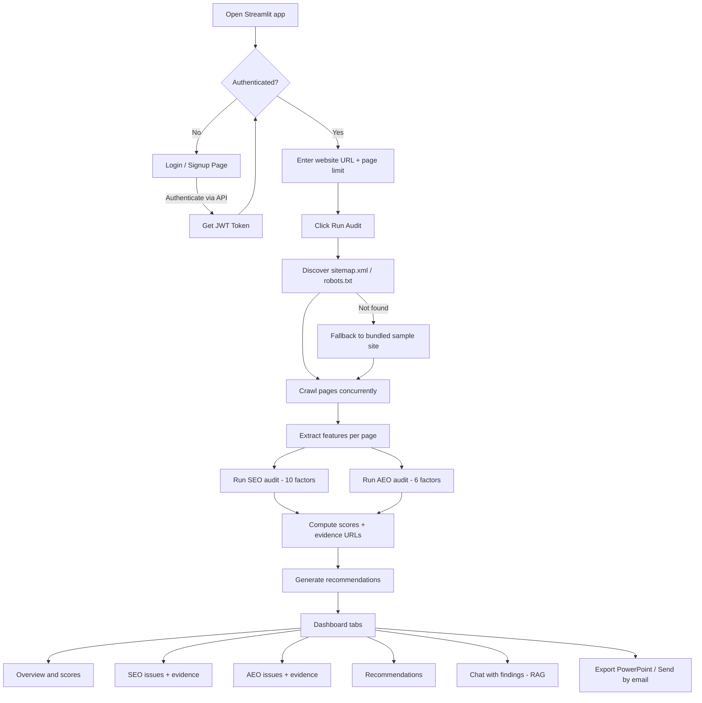
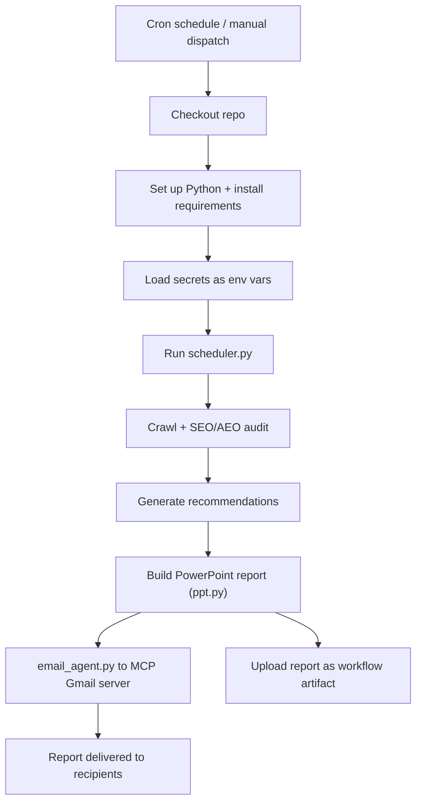

<div align="center">

# 🔍 Automated SEO & AEO Audit

**A scheduled, AI-powered website audit that scores SEO and Answer Engine Optimization (AEO), backs every deduction with evidence, and delivers an executive PowerPoint report by email.**


**Author:** Pendyala Raj Kiran Reddy · [LinkedIn](https://www.linkedin.com/in/raj-kiran-reddy-b248173a6) · [GitHub](https://github.com/rajkiran-ds)

</div>

---

## 📑 Table of Contents

- [Business Problem](#business-problem)
- [Solution Overview](#solution-overview)
- [Features](#features)
- [Tech Stack](#tech-stack)
- [Architecture](#architecture)
- [Folder Structure](#folder-structure)
- [Backend & Authentication](#backend--authentication)
- [Streamlit App Workflow](#streamlit-app-workflow)
- [GitHub Actions Workflow](#github-actions-workflow)
- [LLM Integration (Groq + Local Llama)](#llm-integration-groq--local-llama)
- [MCP Gmail Email Agent](#mcp-gmail-email-agent)
- [Installation](#installation)
- [Environment Variables](#environment-variables)
- [Running Locally](#running-locally)
- [Streamlit Cloud Deployment](#streamlit-cloud-deployment)
- [GitHub Deployment (Scheduled Audits)](#github-deployment-scheduled-audits)
- [Troubleshooting](#troubleshooting)
- [Limitations](#limitations)
- [Future Improvements](#future-improvements)
- [Author](#author)

---

## Business Problem

Websites no longer compete only on Google rankings. Customers increasingly get answers from AI answer engines (ChatGPT, Perplexity, Google AI Overviews), and those engines cite pages that are clear, structured and answer-first.

Marketing teams and agencies face three problems:

| Problem | Impact |
|---------|--------|
| SEO audits are manual, one-off and quickly outdated | Regressions (broken titles, missing canonicals) go unnoticed for weeks |
| Existing tools give a score but no evidence | Teams can't tell which pages caused a deduction or what to fix first |
| AEO readiness (FAQ coverage, entity clarity, answer-first writing) is rarely measured | Brands lose visibility in AI-generated answers |

## Solution Overview

This project crawls a site via its sitemap, scores it on **10 SEO factors** and **6 semantic AEO factors**, and attaches **evidence URLs** to every deduction. It converts findings into short, medium and long-term recommendations, generates a PowerPoint executive report, emails it through an MCP Gmail agent, and lets you chat with the audit results using a local RAG agent.

The platform is secured by a FastAPI backend with JWT authentication, ensuring that user sessions and audit pipelines are restricted to authorized accounts. Audits can run automatically on a schedule with GitHub Actions.

## Features

- **Secure Authentication:** FastAPI backend with OAuth2/JWT enables user signup and login, persisting accounts securely via SQLAlchemy and SQLite.
- **Sitemap discovery:** checks `/sitemap.xml` and `robots.txt` `Sitemap:` directives, handles sitemap-index files, with a bundled sample-site fallback so the demo always works.
- **Concurrent crawling:** up to 20 pages fetched in parallel for fast audits.
- **SEO audit (10 factors):** rule-based checks such as status code, title, meta description, H1 structure, canonical, robots meta, internal links, content depth and image alt text.
- **AEO audit (6 semantic factors):** LLM-assisted scoring of answer-first writing, question-answer readiness, FAQ presence, structured headings, entity clarity and AI-citation readiness.
- **Evidence URLs per deduction:** every lost point links back to the exact pages that caused it.
- **Recommendation engine:** findings are grouped into short-term, medium-term and long-term actions generated from the issues actually found, not generic boilerplate.
- **RAG chat agent:** ask questions such as *"Which pages are missing meta descriptions?"* and get answers grounded in the audit findings (TF-IDF retrieval via scikit-learn + Groq LLM).
- **PowerPoint executive report:** auto-generated `.pptx` with KPIs, charts, issues and the recommendation roadmap.
- **MCP Gmail email agent:** sends the report through a Model Context Protocol Gmail server.
- **Scheduled audits:** GitHub Actions runs the audit on a cron schedule and emails the result.
- **Interactive dashboard:** Plotly gauges, severity charts and top problem pages in Streamlit.

## Tech Stack

<div align="center">


</div>

| Layer | Technology |
|-------|------------|
| UI | Streamlit |
| Backend API | FastAPI, Pydantic, Uvicorn |
| Auth & Database | JWT (`python-jose`), Bcrypt (`passlib`), SQLAlchemy, SQLite |
| Crawling | `requests`, `beautifulsoup4`, `lxml`, `ThreadPoolExecutor` |
| Data | `pandas`, `numpy` |
| Visualization | `plotly`, `kaleido` |
| LLM | Groq API (Llama 3.1), optional local Llama via Ollama |
| RAG | `scikit-learn` (TF-IDF retrieval) |
| Reporting | `python-pptx` (PowerPoint), `reportlab` (PDF), `Pillow` |
| Email | MCP (`mcp`) Gmail server + `email-validator` |
| Automation | GitHub Actions, `scheduler.py` |
| Config | `python-dotenv` |

## Architecture



**Design principles**

- **Secure Gateway:** the Streamlit UI acts as a client, communicating with the FastAPI backend to authenticate users before allowing access to audit pipelines.
- **Modular:** each file has one responsibility and can be tested independently.
- **Evidence-first:** every score deduction carries the URLs that triggered it.
- **Graceful degradation:** AEO falls back to a transparent heuristic scorer if no LLM key is available.

## Folder Structure

```text
seo_aeo_agent/
├── .github/
│   └── workflows/
│       └── audit.yml                 # Scheduled audit (GitHub Actions)
├── .streamlit/
│   └── config.toml                   # Streamlit theme/config
├── api/                              # FastAPI Backend
│   ├── __init__.py
│   ├── database.py                   # SQLAlchemy + SQLite setup
│   ├── main.py                       # API endpoints (Auth & Audits)
│   ├── schemas.py                    # Pydantic request/response models
│   └── security.py                   # JWT & password hashing
├── data/
│   └── api_users.db                  # Persistent SQLite database (created at runtime, git-ignored)
├── app.py                            # Streamlit UI (Auth Gate + Dashboard)
├── crawler.py                        # Sitemap discovery + concurrent crawling
├── feature_engine.py                 # Per-page feature extraction
├── seo.py                            # 10 SEO factors + scoring + evidence URLs
├── aeo.py                            # 6 semantic AEO factors
├── models.py                         # Data models for pages, issues, audit results
├── recommendation_engine.py          # Short / medium / long-term recommendations
├── chat_agent.py                     # RAG chat agent over audit findings
├── ppt.py                            # PowerPoint report generator
├── generate_monthly_report.py        # Monthly report generation entry point
├── scheduler.py                      # Scheduled audit runner (used by GitHub Actions)
├── email_agent.py                    # Email agent (MCP client)
├── mcp_gmail_server.py               # MCP server exposing a Gmail send tool
├── requirements.txt
├── .env.example                      # Environment variable template
├── .gitignore
└── README.md
```

## Backend & Authentication

The platform uses a FastAPI backend to handle user management and secure the multi-agent pipeline.

- **Endpoints:** `/auth/signup`, `/auth/login` (OAuth2 Password Flow), and `/auth/me`.
- **Security:** passwords are hashed using Bcrypt before being stored. Successful logins return a JWT (JSON Web Token) which the Streamlit frontend uses to authenticate subsequent requests.
- **Persistence:** user accounts are stored in `data/api_users.db` using SQLAlchemy, meaning you don't need to re-register on every run.

To start the backend server:

```bash
uvicorn api.main:app --reload --port 8080
```

API documentation is automatically generated at <http://localhost:8080/docs>.

## Streamlit App Workflow



**Typical session**

1. Open the app and sign up or log in.
2. Enter a URL in the sidebar and choose how many pages to crawl.
3. Click **Run Audit** and wait for the crawl and scoring to finish.
4. Review scores, drill into evidence URLs per deduction, and read the recommendations.
5. Ask the chat agent follow-up questions about the findings.
6. Download the PowerPoint report or email it via the MCP Gmail agent.

## GitHub Actions Workflow



Each scheduled run is fully unattended: it audits the configured site, builds the report, uploads it as a workflow artifact and emails it to the configured recipients.

## LLM Integration (Groq + Local Llama)

The LLM powers AEO scoring, recommendation wording, the RAG chat agent and the email agent.

| Mode | Provider | When to use |
|------|----------|-------------|
| **Cloud (default)** | Groq running Llama 3.1 | Fast, free-tier friendly, ideal for Streamlit Cloud and GitHub Actions |
| **Local (optional)** | Llama via Ollama | Offline use, private data, no API limits |
| **No LLM** | Heuristic fallback | Demo mode with no API key; AEO uses a transparent rule-based scorer |

**Groq setup**

```bash
# 1. Create a key at https://console.groq.com/keys
# 2. Put it in .env
GROQ_API_KEY=gsk_xxxxxxxxxxxxxxxxx
```

**Local Llama setup (optional)**

```bash
# Install Ollama from https://ollama.com, then:
ollama pull llama3.1
ollama serve
```

Then set `LLM_PROVIDER=ollama` in `.env`. Set `LLM_PROVIDER=groq` to switch back to the cloud backend.

## MCP Gmail Email Agent

Report delivery uses the **Model Context Protocol (MCP)**:

- `mcp_gmail_server.py` is an MCP server that exposes a `send email` tool backed by Gmail SMTP.
- `email_agent.py` is the MCP client/agent that composes the message (with the LLM) and calls the tool to attach and send the `.pptx` report.
- Recipient addresses are validated with `email-validator` before sending.
- Uses a **bring-your-own-email** design: you supply your own Gmail address and App Password; no credentials are stored in the repo.

Create a Gmail App Password at **Google Account → Security → 2-Step Verification → App passwords**.

## Installation

```bash
# 1. Clone
git clone https://github.com/rajkiran-ds/<your-repo-name>.git
cd <your-repo-name>

# 2. Create a virtual environment
python -m venv venv
source venv/bin/activate          # Windows: venv\Scripts\activate

# 3. Install dependencies
pip install -r requirements.txt

# 4. Configure environment variables
cp .env.example .env              # then edit .env
```

**Requirements:** Python 3.10+, a Groq API key (free), and optionally a Gmail App Password and Ollama.

## Environment Variables

Copy `.env.example` to `.env` and fill in the values:

| Variable | Required | Description |
|----------|----------|-------------|
| `GROQ_API_KEY` | Yes (for LLM features) | Groq API key |
| `API_SECRET_KEY` | Yes (for backend) | Secret key used to sign JWTs (min 32 characters) |
| `LLM_PROVIDER` | No | `groq` (default) or `ollama` |
| `GROQ_MODEL` | No | Groq model name (e.g. `llama-3.1-8b-instant`) |
| `OLLAMA_BASE_URL` | No | Local Ollama URL (default `http://localhost:11434`) |
| `GMAIL_ADDRESS` | For email | Sender Gmail address |
| `GMAIL_APP_PASSWORD` | For email | Gmail App Password (not your login password) |
| `REPORT_RECIPIENTS` | For email | Comma-separated recipient emails |
| `TARGET_URL` | For scheduled runs | Website to audit in GitHub Actions |
| `MAX_PAGES` | No | Pages to crawl (default `20`) |

```env
GROQ_API_KEY=gsk_xxxxxxxxxxxxxxxxx
API_SECRET_KEY=replace_with_a_random_string_of_at_least_32_characters
LLM_PROVIDER=groq
GMAIL_ADDRESS=you@gmail.com
GMAIL_APP_PASSWORD=xxxx xxxx xxxx xxxx
REPORT_RECIPIENTS=team@example.com
TARGET_URL=https://example.com
MAX_PAGES=20
```

Generate a valid `API_SECRET_KEY`:

```bash
python -c "import secrets; print(secrets.token_hex(32))"
```

> [!WARNING]
> Never commit `.env`. It is already listed in `.gitignore`.

## Running Locally

You need to run **both** the backend API and the frontend UI.

**1. Start the FastAPI backend**

```bash
uvicorn api.main:app --reload --port 8080
```

Leave this terminal running.

**2. Start the Streamlit app (in a new terminal)**

```bash
streamlit run app.py
```

Opens at <http://localhost:8501>.

**Scheduled / headless run**

```bash
python scheduler.py
```

**Generate the monthly report**

```bash
python generate_monthly_report.py
```

## Streamlit Cloud Deployment

1. Push the project to a public or private GitHub repo.
2. Go to [share.streamlit.io](https://share.streamlit.io) and click **New app**.
3. Select the repository, branch `main` and main file `app.py`.
4. Open **Advanced settings → Secrets** and paste:

```toml
GROQ_API_KEY = "gsk_xxxxxxxxxxxxxxxxx"
API_SECRET_KEY = "replace_with_a_random_string_of_at_least_32_characters"
LLM_PROVIDER = "groq"
GMAIL_ADDRESS = "you@gmail.com"
GMAIL_APP_PASSWORD = "xxxx xxxx xxxx xxxx"
```

5. Click **Deploy**. Streamlit Cloud installs `requirements.txt` automatically.

> [!NOTE]
> **Authentication:** if you deploy the frontend to Streamlit Cloud, you must also deploy the FastAPI backend to a public host (like Render or Railway) and update the `API_URL` environment variable in `app.py` to point to it.

## GitHub Deployment (Scheduled Audits)

1. Push the repo to GitHub.
2. Go to **Settings → Secrets and variables → Actions → New repository secret** and add: `GROQ_API_KEY`, `GMAIL_ADDRESS`, `GMAIL_APP_PASSWORD`, `REPORT_RECIPIENTS`, `TARGET_URL`.
3. Edit the cron expression in `.github/workflows/audit.yml`:

```yaml
on:
  schedule:
    - cron: "0 3 1 * *"     # 03:00 UTC on the 1st of every month
  workflow_dispatch:         # allow manual runs
```

4. Open the **Actions** tab and run the workflow manually once to verify it.
5. Download generated reports from the run's **Artifacts** section, or receive them by email.

## Troubleshooting

| Issue | Fix |
|-------|-----|
| `ModuleNotFoundError` | Ensure your virtual environment is activated and run `pip install -r requirements.txt` |
| `422 Validation Error` on login | Ensure you are sending `username` and `password` as **form data**, not JSON |
| `401 Unauthorized` | Your JWT token has expired or is missing. Log out and log back in. |
| Sitemap not found | The app falls back to a bundled sample site and shows a banner |
| Groq `401` error | Check `GROQ_API_KEY` in `.env` or Streamlit secrets |
| Gmail authentication failed | Use a Gmail **App Password** with 2-Step Verification enabled |

## Limitations

- **In-memory audit state:** in the FastAPI backend, generated audits are stored in memory (`_audits` dict) to keep the demo lightweight. A production system would use Redis or a persistent database to store audit results.
- **Local RAG retrieval:** the chat agent uses TF-IDF via scikit-learn to ground answers. While fast and dependency-free, it is limited to keyword matching and does not capture semantic meaning like vector embeddings do.
- Crawling is capped at 20 pages and a 10-second timeout per request to keep audits fast.
- JavaScript-rendered content is not executed (static HTML only).

## Future Improvements

- **Semantic RAG:** migrate the chat agent from TF-IDF to a vector database (FAISS/Chroma) with Hugging Face embeddings for true semantic search.
- Headless-browser crawling (Playwright) for JavaScript-heavy sites
- Historical trend tracking: store audits and chart score changes over time
- Core Web Vitals and PageSpeed Insights integration
- Slack / Microsoft Teams alerts when scores drop below a threshold
- Docker image and CI tests for one-command deployment

## Author

**Pendyala Raj Kiran Reddy**
AI/ML Engineer · Data Science · Generative AI

[](https://www.linkedin.com/in/raj-kiran-reddy-b248173a6)
[](https://github.com/rajkiran-ds)

<div align="center">

⭐ If you found this project useful, consider giving it a star!

</div>